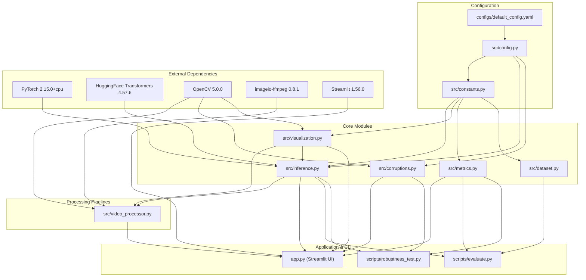

# System Dependency Graph

## Module Couplings & Invariants
1. `src/constants.py` is the single source of truth for the 19 Cityscapes evaluation classes and their RGB palette colors.
2. `src/config.py` provides lazy singleton access with support for environment overrides (`HF_HOME`, `TORCH_HOME`).
3. `src/inference.py` handles input dimension validation, model forward passes, and bilinear upsampling to input resolution.
4. `src/video_processor.py` depends on `imageio_ffmpeg` for FFmpeg binary location; imported lazily in `src/__init__.py`.
5. `src/metrics.py` implements pure NumPy confusion matrix accumulation with zero PyTorch dependency.
